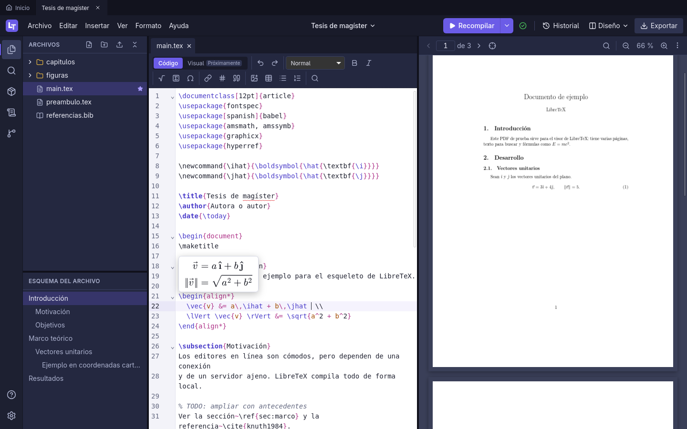
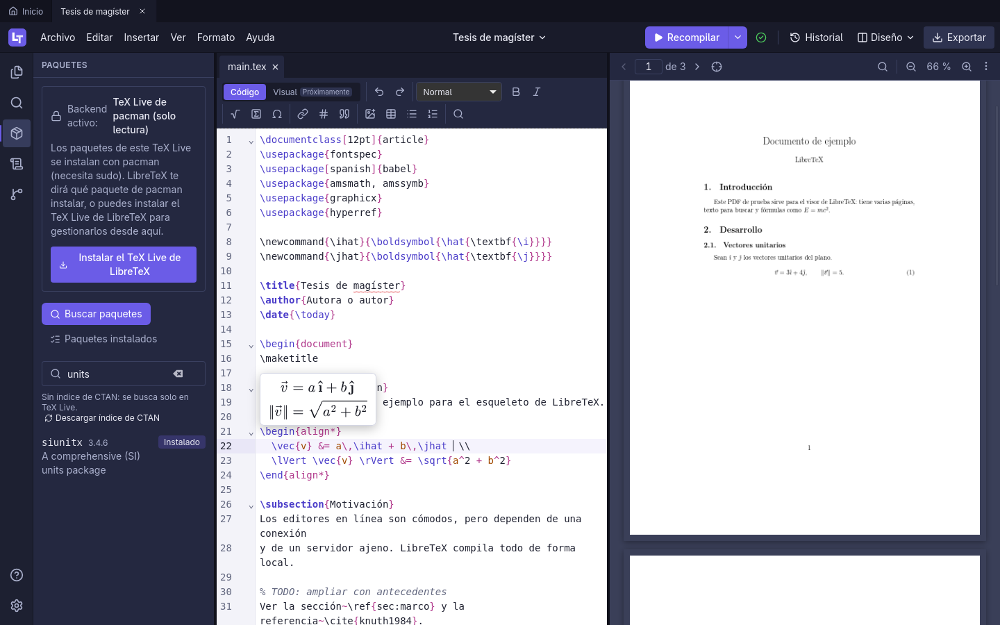
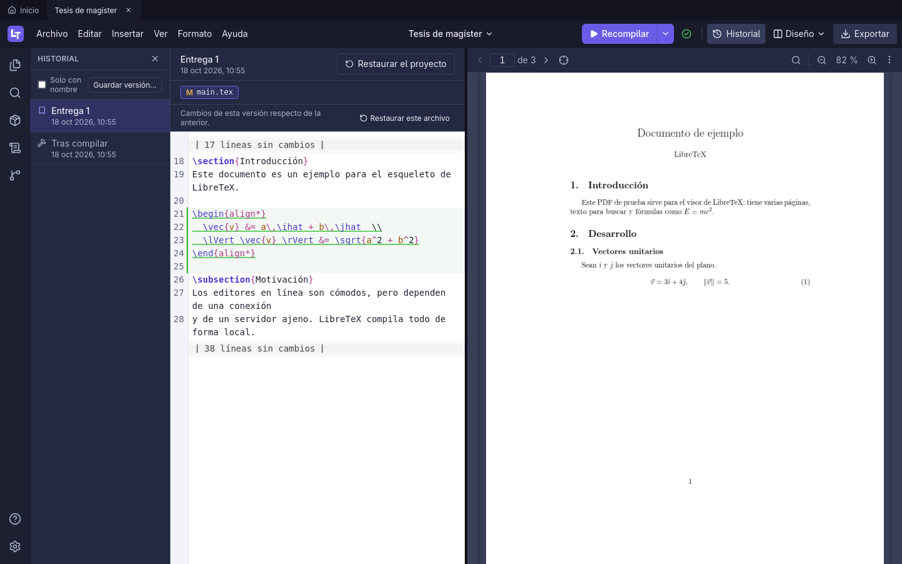
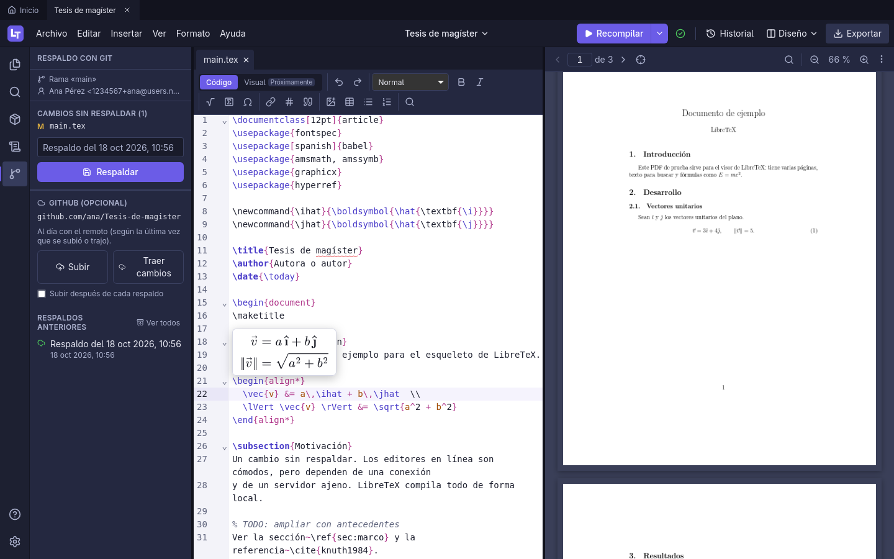
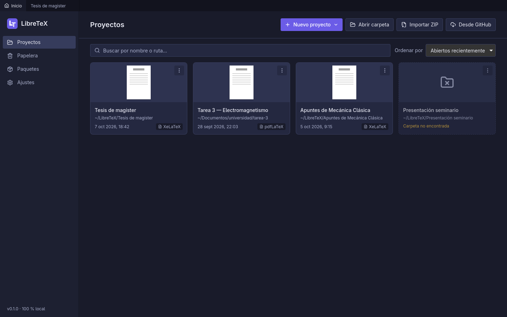

# LibreTeX

Editor de LaTeX de escritorio con una experiencia similar a Overleaf, pero **100 % local**:
los proyectos viven en tu disco, se compilan con la distribución TeX de tu máquina y no hay
servidores, cuentas ni telemetría. Solo el gestor de paquetes y el respaldo en GitHub usan
internet, y únicamente cuando tú lo pides.



## Qué hace

**Proyectos**
- Lista de proyectos con búsqueda y orden; varios proyectos abiertos a la vez en pestañas.
- Crear desde plantillas (artículo XeLaTeX en español, apuntes, tarea, Beamer), abrir una
  carpeta, importar un ZIP (también los de Overleaf) o traer un proyecto desde GitHub.
- Papelera propia (es la del sistema): restaurar o eliminar definitivamente.

**Editor**
- CodeMirror 6 con resaltado, plegado de entornos y secciones, cierre automático de llaves,
  `$` y entornos, comentar con `Ctrl+/` y teclados Vim o Emacs opcionales.
- Autocompletado de comandos y entornos (los de matemáticas primero dentro de una fórmula),
  de tus propios `\newcommand`, de `\ref` y `\cite` del proyecto y de rutas de archivos.
- **Vista previa de matemáticas en vivo** con MathJax, que entiende las macros de tu
  preámbulo.
- Revisión en vivo de llaves, entornos y fórmulas sin cerrar mientras escribes, y revisión
  ortográfica en español e inglés con diccionario personal.
- Buscar y reemplazar en el archivo y en todo el proyecto (texto o expresión regular).
- Recuerda dónde quedaste: archivos abiertos, cursor de cada uno y página del PDF.

**Compilación y PDF**
- `latexmk` con pdfLaTeX, XeLaTeX o LuaLaTeX; siempre manual (`Ctrl+Enter`), con la salida
  en vivo y los errores enlazados a su línea.
- Visor PDF integrado que conserva la página y el zoom al recompilar, con búsqueda y SyncTeX
  en ambos sentidos (`Ctrl+J` y doble clic en el PDF).
- Exportar el PDF (`Ctrl+Shift+S`) o un ZIP de fuentes listo para Overleaf.

**Paquetes**
- Busca en TeX Live y en CTAN, instala, actualiza y desinstala; si al compilar falta un
  `.sty`, ofrece instalar el paquete y recompilar con un clic.
- Si tu TeX Live es el de pacman (solo lectura), te dice qué paquete de pacman instalar.



**Historial y respaldo**
- Historial local automático (cada pocos minutos y tras compilar) y versiones con nombre;
  diferencias por archivo y restaurar un archivo o el proyecto entero.
- Respaldo opcional con el Git del proyecto y, si quieres, en un repositorio privado de
  GitHub: subir, traer cambios y continuar en otra máquina. LibreTeX no guarda contraseñas
  ni tokens.







## Requisitos (Arch Linux)

```sh
sudo pacman -S --needed webkit2gtk-4.1 git
```

`git` se usa para el respaldo con Git. Para listar tus repositorios de GitHub y crear uno
nuevo desde la app hace falta además GitHub CLI (`sudo pacman -S github-cli` y luego
`gh auth login`).

### Distribución TeX (opcional)

Para compilar hace falta una distribución TeX, pero no es necesario instalarla antes. Hay
dos caminos, y si tienes los dos, eliges cuál usar en **Paquetes** o en **Ajustes**:

- **TeX Live de LibreTeX** (sin sudo): en la pestaña **Paquetes**, «Instalar el TeX Live de
  LibreTeX». Descarga unos 80 MB desde CTAN, ocupa unos 210 MB en
  `~/.local/share/libretex/texlive` y no toca el sistema. Trae lo necesario para XeLaTeX en
  español; los demás paquetes se instalan, actualizan y desinstalan desde la propia app.
- **TeX Live de pacman**: LibreTeX lo usa tal cual. Sus paquetes no se pueden instalar
  desde la app; cuando falta uno, LibreTeX te dice qué paquete de pacman lo trae. Un
  conjunto razonable para empezar:

  ```sh
  sudo pacman -S --needed texlive-basic texlive-latex texlive-latexrecommended \
    texlive-latexextra texlive-xetex texlive-langspanish texlive-binextra
  ```

## Atajos principales

| Atajo | Acción |
|---|---|
| `Ctrl+S` | Guardar (no compila) |
| `Ctrl+Enter` | Compilar |
| `Ctrl+Shift+S` | Guardar el PDF compilado como… |
| `Ctrl+Shift+F` | Buscar en el proyecto |
| `Ctrl+J` / doble clic en el PDF | SyncTeX: del código al PDF y del PDF al código |
| `Ctrl+Tab` | Pestaña siguiente |
| `F1` | Todos los atajos |

## Desarrollo

Requisitos adicionales:

```sh
sudo pacman -S --needed rustup nodejs pnpm base-devel curl wget file openssl \
  appmenu-gtk-module libappindicator-gtk3 librsvg
rustup default stable
```

```sh
pnpm install
pnpm tauri dev        # app en modo desarrollo
pnpm test             # tests del frontend (Vitest)
pnpm typecheck
pnpm lint
cargo test --manifest-path src-tauri/Cargo.toml
cargo clippy --manifest-path src-tauri/Cargo.toml -- -D warnings
```

Compilar el paquete de la aplicación:

```sh
pnpm tauri build
```

El plan de construcción, las decisiones de diseño y el estado del proyecto están en
[`CLAUDE.md`](CLAUDE.md). Las capturas salen de la vista previa con datos de ejemplo.

### Wayland + NVIDIA

Con el driver de NVIDIA, el renderer DMA-BUF de WebKitGTK cierra la conexión con Wayland
(«Error 71») por la sincronización explícita del driver. LibreTeX define
`__NV_DISABLE_EXPLICIT_SYNC=1` en Wayland + NVIDIA, así la página se sigue dibujando con la
GPU (scroll fluido). Las variables que ya hayas definido se respetan.

Si en tu sistema la ventana sigue fallando, el modo anterior (sin aceleración, más lento)
se activa así:

```sh
LIBRETEX_SAFE_RENDERER=1 libretex
```

## Licencia

[GPL-3.0-or-later](LICENSE).
